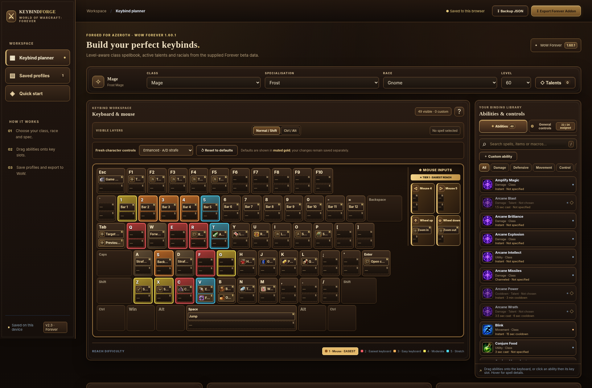

# Keybind Forge — WoW Forever (v2.3)

A free, community-made **World of Warcraft: Forever** keybind planning web app. Interactive fantasy keyboard + mouse, drag-and-drop spell binding, default game controls, Shift/Ctrl/Alt layers, saved layouts, ergonomic recommendations, and full-layout suggestions.



## Publish on GitHub Pages (no coding needed)

1. **Download and extract** the repository ZIP. Upload the extracted **contents**, not the ZIP itself or its enclosing folder.
2. Sign into [GitHub](https://github.com/) and create a **new public repository**. A name such as `keybind-forge-forever` is fine. You may leave **Add a README** unchecked because one is included here.
3. In the empty repository, choose **uploading an existing file** (or **Add file → Upload files**). Drag in **all files and folders inside** the extracted `keybind-forge-github-pages` folder. Ensure `index.html` is at the **repository root**, alongside `README.md` and `assets/`.
4. Commit the upload to the default **`main`** branch.
5. Navigate to **Settings → Pages**. Under **Build and deployment**, set **Source** to **Deploy from a branch**, then select **`main`** and **`/(root)`**. Click **Save**.
6. Once GitHub publishes the site, you'll see a **Visit site** link in Settings → Pages. Typical project site URL: `https://YOUR-USERNAME.github.io/keybind-forge-forever/` (substitute your username and exact repository name).

Updates after that are easy: change the relevant file(s) in GitHub and commit them to `main`. No npm, build tools, workflow, database, or external hosting service is required.

> **Important:** GitHub's **Import repository** tool imports a Git repository from a URL, *not a ZIP file*. Use **Upload files** as above, or use GitHub Desktop / Git on your computer to publish the extracted folder.

## Saved layouts

Character layouts are stored **locally in each browser** (`localStorage`), not in GitHub. Your old ChatGPT preview / local HTML app and the GitHub Pages website have different storage, so the layouts **do not automatically migrate**. Before switching, use the app's **Backup JSON** control, then open the new Pages website and use **Saved layouts → Import JSON** to transfer your layouts. Profile data is not uploaded to a server.

## Where the code is

```
index.html                      Main app HTML (GitHub Pages entry point)
assets/css/styles.css           Dark fantasy theme, keyboard layout and embedded art
assets/js/game-data.js          Game controls and other built-in planner data
assets/js/forever-data.js       Bundled Talents Forever JSON snapshot
assets/js/app.js                Planner logic, bindings, tooltip and generator
assets/js/keyboard-sizing.js    Responsive keyboard sizing
assets/images/favicon.svg       App icon
assets/images/preview.png       Repository preview screenshot
.nojekyll                       Prevents Jekyll processing on GitHub Pages
ATTRIBUTION.md                 Data and artwork credits
```

All asset paths are **relative**, so this site works under GitHub's project subpath as well as the root of a domain. For a local preview, open `index.html` in Chrome or Edge, or run a simple HTTP server from this folder (`python -m http.server 8000`).

## Data and limitations

The built-in game data is based on the **2026-10-30 beta export**, not a live real-time game API. Spellbook entries, levels, talents, and tooltips may differ from later WoW Forever builds. The ergonomic and rotation advice is a community prototype, not an official Blizzard guide. Most spell icons are loaded at runtime from Wowhead's image CDN, so **an internet connection** is needed for those; selected interface icons and fallback artwork are bundled locally.

The data includes [Talents Forever](https://talentsforever.com/) material licensed **CC BY 4.0**. See [ATTRIBUTION.md](ATTRIBUTION.md). This project is not affiliated with or endorsed by Blizzard Entertainment or Wowhead.

## Pages help

Official GitHub docs: [configure a publishing source](https://docs.github.com/en/pages/getting-started-with-github-pages/configuring-a-publishing-source-for-your-github-pages-site).

## v2.4 layout

The keyboard-first workspace puts the full keyboard and mouse at left and a two-column spell/control library on the right. Recommendations, generator, warnings and rotations are in an expandable section.
